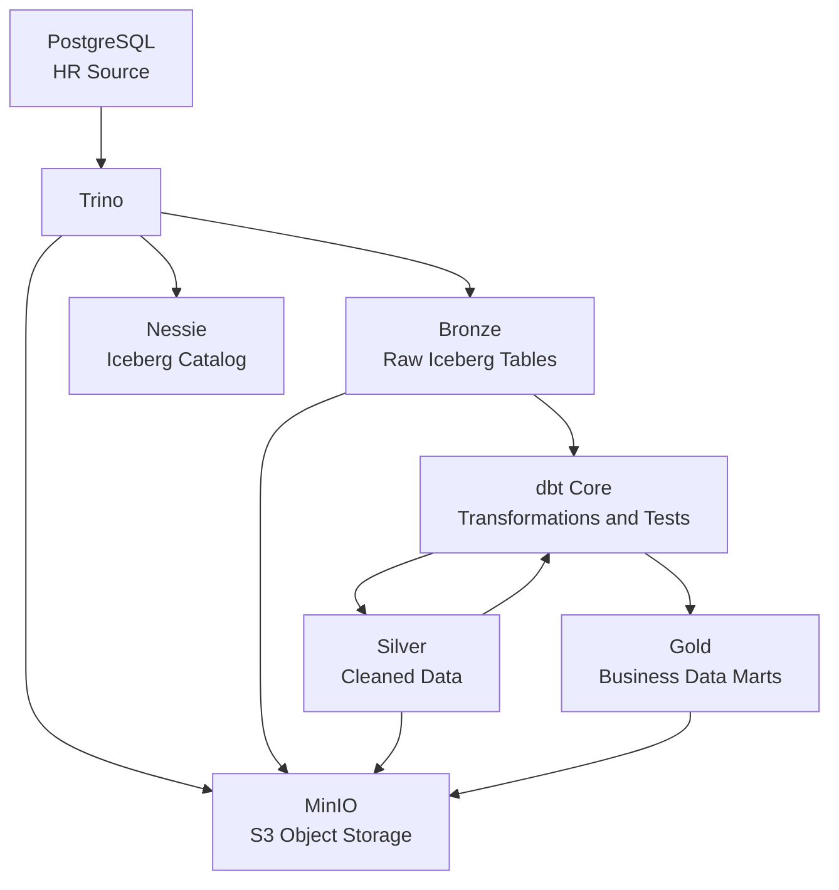

# HR Lakehouse — Trino, Iceberg, Nessie & dbt

Локальный Data Engineering проект по построению аналитического HR-хранилища в архитектуре Lakehouse.

Проект демонстрирует полный цикл работы с данными: от PostgreSQL Source до аналитических витрин Bronze / Silver / Gold с использованием Trino, Apache Iceberg, MinIO, Project Nessie и dbt Core.

## 1. Технологический стек

| Технология | Версия | Назначение |
|---|---|---|
| PostgreSQL | 17 | Исходная HR-база данных |
| Trino | 484 | SQL-движок |
| Apache Iceberg | 1.12.0 | Табличный формат Lakehouse |
| MinIO | RELEASE.2026-08-04 | S3-совместимое хранилище |
| Project Nessie | 0.109.0 | Каталог и управление версиями Iceberg |
| dbt Core | 1.11.12 | SQL-трансформации и тестирование |
| dbt-trino | 1.11.0 | Адаптер dbt для Trino |
| Docker Compose | v2 | Локальная инфраструктура |
| Python | 3.11 | Среда выполнения dbt |

## 2. Архитектура



**Распределение ответственности:**

- PostgreSQL — хранение исходных HR-данных.
- Trino — выполнение SQL-запросов и взаимодействие с источниками.
- Apache Iceberg — табличный формат, snapshots и метаданные таблиц.
- MinIO — физическое хранение файлов данных и метаданных Iceberg.
- Project Nessie — управление каталогом Iceberg и состояниями его версий.
- dbt — управление зависимостями SQL-моделей, трансформациями и тестами качества.

## 3. Структура репозитория

```text
trino-iceberg-lab/
│
├── docker-compose.yml
├── requirements.txt
├── .env.example
├── .gitignore
├── README.md
│
├── docker/
│   ├── postgres/
│   │   └── init/
│   │       └── 01-create-nessie-db.sql
│   │
│   └── trino/
│       ├── catalog/
│       │   ├── iceberg.properties
│       │   └── postgres.properties
│       ├── config.properties
│       ├── jvm.config
│       └── node.properties
│
├── dbt/
│   ├── dbt_project.yml
│   ├── macros/
│   │   └── generate_schema_name.sql
│   ├── models/
│   │   ├── schema.yml
│   │   ├── sources.yml
│   │   ├── silver/
│   │   │   ├── stg_departments.sql
│   │   │   ├── stg_employees.sql
│   │   │   ├── stg_employee_events.sql
│   │   │   ├── stg_employment_history.sql
│   │   │   └── stg_positions.sql
│   │   └── gold/
│   │       ├── dm_employee_headcount.sql
│   │       ├── dm_employee_movements.sql
│   │       └── dm_employee_turnover.sql
│   │
│   └── tests/
│       ├── assert_dm_employee_headcount_non_negative.sql
│       ├── assert_dm_employee_headcount_unique_grain.sql
│       ├── assert_dm_employee_movements_history_match.sql
│       ├── assert_dm_employee_movements_required_fields.sql
│       ├── assert_dm_employee_movements_source_completeness.sql
│       ├── assert_dm_employee_movements_unique_event.sql
│       ├── assert_dm_employee_movements_valid_event_type.sql
│       ├── assert_dm_employee_turnover_non_negative.sql
│       ├── assert_dm_employee_turnover_rate_not_null.sql
│       ├── assert_dm_employee_turnover_terminations_not_exceed_start.sql
│       └── assert_dm_employee_turnover_unique_grain.sql
│
└── sql/
    ├── README.md
    ├── checks/
    │   └── 01_validate_postgres_catalog.sql
    ├── iceberg/
    │   ├── 01_create_bronze_schema.sql
    │   ├── 02_create_bronze_employees.sql
    │   ├── 03_create_bronze_tables.sql
    │   ├── 04_checks_bronze_tables.sql
    │   ├── 05_create_silver_schema.sql
    │   ├── 06_checks_silver_tables.sql
    │   ├── 07_create_gold_schema.sql
    │   └── 08_checks_gold_tables.sql
    └── source/
        ├── 01_create_source_tables.sql
        ├── 02_load_sample_data.sql
        └── 03_validate_source_data.sql
```

## 4. Исходные данные

Используется синтетическая HR-база PostgreSQL.

| Таблица | Описание | Строк |
|---|---|---:|
| `employees` | Сотрудники | 12 |
| `departments` | Подразделения | 6 |
| `positions` | Должности | 8 |
| `employment_history` | История трудоустройства | 14 |
| `employee_events` | Кадровые события | 10 |
| **Всего** | | **50** |

Данные включают:
- активных и уволенных сотрудников;
- историю работы в подразделениях;
- изменения должностей и повышения;
- события приёма, повышения и увольнения.

Используются только синтетические данные.

## 5. Слои хранилища

В проекте реализована архитектура Bronze / Silver / Gold.

| Слой | Trino schema | Назначение |
|---|---|---|
| Bronze | `iceberg.bronze` | Исходные данные в Iceberg |
| Silver | `iceberg.silver` | Очищенные и стандартизированные данные |
| Gold | `iceberg.gold` | Аналитические HR-витрины |

### Bronze

Данные переносятся из PostgreSQL в Iceberg с помощью Trino CTAS.

Создаются таблицы:
- `employees`
- `departments`
- `positions`
- `employment_history`
- `employee_events`

При загрузке добавляется техническое поле `_ingested_at`.

### Silver

Реализован через dbt staging-модели.

Основные задачи:
- очистка текстовых полей;
- удаление лишних пробелов;
- нормализация значений;
- подготовка данных для бизнес-трансформаций.

Модели:
- `stg_employees`
- `stg_departments`
- `stg_positions`
- `stg_employment_history`
- `stg_employee_events`

### Gold

Содержит три аналитические витрины.

#### `dm_employee_headcount`

Ежемесячная численность сотрудников по подразделениям.

Показатели:
- `report_month`;
- `report_date`;
- `department_id`;
- `department_name`;
- `headcount`.

Особенности:
- расчёт численности на конец каждого закрытого месяца;
- учёт дат приёма и увольнения;
- учёт периодов работы в подразделениях;
- сохранение подразделений с нулевой численностью;
- исключение текущего незакрытого месяца.

#### `dm_employee_turnover`

Аналитика текучести персонала по подразделениям.

Показатели:
- `report_month`;
- `report_date`;
- `department_id`;
- `department_name`;
- `headcount_start`;
- `headcount_end`;
- `termination_count`;
- `turnover_rate`.

Формула:

```text
Average Headcount =
    (Headcount Start + Headcount End) / 2

Turnover Rate =
    Termination Count / Average Headcount * 100
```

При нулевой численности на начало и конец месяца показатель устанавливается в `0`.

При определении подразделения уволенного сотрудника используется последняя запись истории трудоустройства, закрытая датой увольнения.

#### `dm_employee_movements`

Витрина кадровых событий:
- приём сотрудников;
- повышение;
- увольнение.

Содержит информацию о сотруднике, дате события, подразделении, текущей и предыдущей должности.

Для определения предыдущей должности используется оконная функция `LAG()`.

## 6. Настройка и запуск

### Требования

- Docker Desktop с WSL2.
- Docker Compose v2.
- Python 3.11.
- Git.
- PowerShell.

### Клонирование репозитория

```powershell
git clone https://github.com/eerokhin/trino-iceberg-lab.git

cd trino-iceberg-lab
```

### Настройка переменных окружения

Создать `.env` из шаблона:

```powershell
Copy-Item .env.example .env
```

Пример `.env.example`:

```dotenv
POSTGRES_DB=hr_source
POSTGRES_USER=lab
POSTGRES_PASSWORD=change_me

MINIO_ROOT_USER=minioadmin
MINIO_ROOT_PASSWORD=change_me
```

Для локального окружения необходимо задать собственные пароли.

### Запуск Docker-инфраструктуры

```powershell
docker compose up -d
```

Проверка контейнеров:

```powershell
docker compose ps
```

Используются сервисы:

| Сервис | Адрес |
|---|---|
| PostgreSQL | `localhost:5433` |
| Trino | `http://localhost:8080` |
| MinIO API | `http://localhost:9000` |
| MinIO Console | `http://localhost:9001` |
| Nessie API | `http://localhost:19120` |

В MinIO необходимо убедиться, что создан bucket `warehouse`.

### Подготовка PostgreSQL Source

SQL-скрипты выполняются через прямое подключение к PostgreSQL, например в DBeaver.

Параметры подключения:
- Host: `localhost`
- Port: `5433`
- Database: `hr_source`
- User и Password: значения из `.env`.

Порядок выполнения:

```text
sql/source/01_create_source_tables.sql
sql/source/02_load_sample_data.sql
sql/source/03_validate_source_data.sql
```

**Важно:** скрипт загрузки тестовых данных очищает существующие таблицы перед повторной загрузкой. Не запускайте его повторно без необходимости.

### Подготовка Bronze

SQL-скрипты из `sql/iceberg/` выполняются через Trino-подключение в DBeaver.

Последовательность:

```text
01_create_bronze_schema.sql
02_create_bronze_employees.sql
03_create_bronze_tables.sql
04_checks_bronze_tables.sql
```

Данные переносятся из PostgreSQL catalog в Iceberg Bronze.

### Подготовка Silver и Gold

Silver и Gold создаются и обновляются через dbt.

SQL-скрипты `05–08` из `sql/iceberg/` содержат операции подготовки схем и проверки результатов. При повторном выполнении следуйте назначению конкретного скрипта и проверяйте наличие объектов.

## 7. Настройка dbt

### Создание виртуального окружения

Из корня проекта:

```powershell
python -m venv .venv

.\.venv\Scripts\Activate.ps1
```

### Установка зависимостей

```powershell
python -m pip install -r requirements.txt
```

### Настройка профиля

Создать файл:

```text
%USERPROFILE%\.dbt\profiles.yml
```

Используемый профиль HR-проекта:

```yaml
hr_dbt:
  target: dev
  outputs:
    dev:
      type: trino
      method: none
      user: hr_user
      host: localhost
      port: 8080
      database: iceberg
      schema: silver
      threads: 4
      http_scheme: http
```

В `dbt/dbt_project.yml` указан профиль `hr_dbt`.

### Проверка подключения

Из корня проекта:

```powershell
dbt debug --project-dir .\dbt
```

### Запуск моделей

Все модели:

```powershell
dbt run --project-dir .\dbt
```

Silver:

```powershell
dbt run --project-dir .\dbt --select silver
```

Gold:

```powershell
dbt run --project-dir .\dbt --select gold
```

Отдельная модель:

```powershell
dbt run --project-dir .\dbt --select dm_employee_headcount
```

Проверка качества данных:

```powershell
dbt test --project-dir .\dbt
```

## 8. Data Quality

Для контроля качества используются generic и singular dbt tests.

Проверяются:
- уникальность первичных ключей;
- отсутствие NULL в обязательных полях;
- допустимые значения статусов;
- корректность связей между таблицами;
- уникальность зерна витрин;
- отсутствие отрицательных значений численности;
- корректность показателей текучести;
- уникальность кадровых событий;
- соответствие кадровых событий истории трудоустройства.

**Результат последнего полного запуска:**

```text
PASS=35
WARN=0
ERROR=0
SKIP=0
NO-OP=0
TOTAL=35
```

Все 35 тестов пройдены.

## 9. Результаты

| Витрина | Количество строк |
|---|---:|
| `dm_employee_headcount` | 492 |
| `dm_employee_turnover` | 492 |
| `dm_employee_movements` | 10 |

Месячные витрины содержат 82 закрытых отчётных месяца по 6 подразделениям.

Последний отчётный период — октябрь 2026 года.

## 10. Практические задачи

В процессе разработки реализованы:

1. Развёртывание локальной инфраструктуры через Docker Compose.
2. Подключение PostgreSQL к Trino через отдельный catalog.
3. Перенос исходных данных в Iceberg Bronze.
4. Настройка S3-совместимого хранилища MinIO.
5. Подключение Project Nessie.
6. Построение Silver staging-моделей через dbt.
7. Проектирование Gold-витрин.
8. Расчёт численности и текучести персонала.
9. Обработка истории трудоустройства и кадровых событий.
10. Создание автоматизированных проверок качества данных.
11. Диагностика и восстановление Iceberg-таблиц после ошибки `ICEBERG_MISSING_METADATA`.

## 11. Управление инфраструктурой

Запуск:

```powershell
docker compose up -d
```

Остановка контейнеров:

```powershell
docker compose stop
```

Перезапуск:

```powershell
docker compose restart
```

Просмотр логов:

```powershell
docker compose logs -f
```

Удаление контейнеров без удаления данных:

```powershell
docker compose down
```

**Важно:** команда `docker compose down -v` удаляет также Docker volumes с данными PostgreSQL и MinIO.

## 12. Отдельные эксперименты

В репозитории также сохранена модель `dbt/models/stg_test_orders.sql`, которая обращается к `iceberg.lab.test_orders`.

Это отдельный эксперимент с тестовой Iceberg-таблицей, не входящий в HR-поток. Для успешного запуска всех моделей необходимо, чтобы исходная таблица `iceberg.lab.test_orders` существовала.

## 13. Дальнейшее развитие

Возможные направления расширения проекта:

- инкрементальные загрузки и CDC;
- Kafka и Debezium;
- Spark для распределённых трансформаций;
- dbt snapshots;
- эксперименты с Nessie branches и tags;
- автоматизация пайплайнов через Airflow;
- расширение набора Data Quality проверок.

Эти компоненты пока не входят в реализованную архитектуру проекта.

---

**Статус:** Bronze, Silver и Gold реализованы. Все 35 dbt-тестов успешно пройдены.