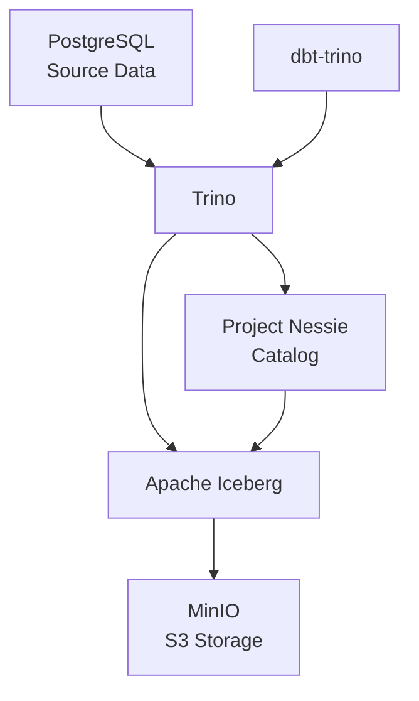

# Trino Iceberg Lab

Локальная лаборатория для изучения современной архитектуры Data Lakehouse на базе Trino, Apache Iceberg, MinIO, Project Nessie, PostgreSQL и dbt.

Проект предназначен для практического изучения хранения, обработки, трансформации и управления данными с использованием SQL и dbt.

## Цели проекта

- Изучить Trino и работу с несколькими источниками данных.
- Освоить Apache Iceberg и его механизм управления версиями данных.
- Разобраться с объектным хранилищем MinIO и S3 API.
- Изучить Project Nessie и версионирование каталогов.
- Освоить dbt для построения SQL-моделей.
- Реализовать архитектуру преобразования данных Bronze / Silver / Gold.
- На практике изучить инкрементальную загрузку и контроль качества данных.

## Архитектура

### Технологический стек

| Компонент | Назначение |
|---|---|
| Trino 484 | SQL-движок для выполнения запросов |
| Apache Iceberg | Табличный формат для Lakehouse |
| MinIO | S3-совместимое объектное хранилище |
| Project Nessie 0.109.0 | Каталог и версионирование Iceberg |
| PostgreSQL 17 | Реляционный источник и хранилище Nessie |
| dbt Core 1.11.12 | Управление SQL-трансформациями |
| dbt-trino 1.11.0 | Адаптер dbt для Trino |
| Docker Compose | Запуск локальной инфраструктуры |
| Python 3.11 | Среда выполнения dbt |

### Схема взаимодействия



Trino выступает SQL-движком, через который выполняются запросы к PostgreSQL и Iceberg.

Nessie управляет каталогом Iceberg и версиями его состояния.

MinIO хранит физические файлы данных Parquet и метаданные Iceberg.

dbt управляет SQL-моделями и выполняет трансформации через Trino.

## Структура репозитория

```text
trino-iceberg-lab/
│
├── docker-compose.yml
├── requirements.txt
├── .env.example
├── .gitignore
├── README.md
│
├── docker/
│   ├── postgres/
│   │   └── init/
│   │       └── 01-create-nessie-db.sql
│   │
│   └── trino/
│       ├── catalog/
│       │   ├── iceberg.properties
│       │   └── postgres.properties
│       ├── config.properties
│       ├── jvm.config
│       └── node.properties
│
├── dbt/
│   ├── dbt_project.yml
│   └── models/
│       └── stg_test_orders.sql
│
└── sql/
    ├── checks/
    ├── iceberg/
    └── source/
```

## Требования

Для запуска проекта необходимы:

- Docker Desktop.
- Docker Compose v2.
- Python 3.11.
- Git.
- PowerShell.

## Запуск проекта

### 1. Клонирование репозитория

```powershell
git clone <repository-url>
cd trino-iceberg-lab
```

### 2. Настройка переменных окружения

Создать локальный файл `.env` на основе шаблона:

```powershell
Copy-Item .env.example .env
```

Пример содержимого `.env`:

```dotenv
POSTGRES_DB=hr_source
POSTGRES_USER=lab
POSTGRES_PASSWORD=change_me

MINIO_ROOT_USER=minioadmin
MINIO_ROOT_PASSWORD=change_me
```

Используйте собственные пароли для локального окружения.

### 3. Запуск инфраструктуры

```powershell
docker compose up -d
```

Проверка состояния контейнеров:

```powershell
docker compose ps
```

PostgreSQL должен перейти в состояние `healthy`.

### 4. Доступ к сервисам

| Сервис | Адрес |
|---|---|
| Trino | http://localhost:8080 |
| MinIO API | http://localhost:9000 |
| MinIO Console | http://localhost:9001 |
| Nessie API | http://localhost:19120 |

## Работа с Trino

Подключение к Trino CLI:

```powershell
docker exec -it trino-lab-trino trino
```

Просмотр доступных каталогов:

```sql
SHOW CATALOGS;
```

Ожидаемый результат:

```text
iceberg
postgres
system
```

Просмотр схем PostgreSQL:

```sql
SHOW SCHEMAS FROM postgres;
```

Просмотр схем Iceberg:

```sql
SHOW SCHEMAS FROM iceberg;
```

## Apache Iceberg

Для лабораторных экспериментов используется схема `iceberg.lab`.

Создание схемы:

```sql
CREATE SCHEMA iceberg.lab
WITH (
    location = 's3://warehouse/lab/'
);
```

Пример создания таблицы:

```sql
CREATE TABLE iceberg.lab.orders (
    order_id INTEGER,
    customer_name VARCHAR,
    amount DECIMAL(10, 2)
)
WITH (
    format = 'PARQUET'
);
```

Добавление данных:

```sql
INSERT INTO iceberg.lab.orders VALUES
    (1, 'Alice', 125.50),
    (2, 'Bob', 200.00),
    (3, 'Charlie', 350.00);
```

Просмотр данных:

```sql
SELECT *
FROM iceberg.lab.orders;
```

### Iceberg Snapshots

Iceberg сохраняет историю изменений таблицы в виде snapshots.

Получение истории:

```sql
SELECT
    snapshot_id,
    parent_id,
    operation,
    committed_at
FROM iceberg.lab."orders$snapshots"
ORDER BY committed_at;
```

### Time Travel

Чтение данных на момент определённого snapshot:

```sql
SELECT *
FROM iceberg.lab.orders
FOR VERSION AS OF <snapshot_id>;
```

Это позволяет обращаться к предыдущим состояниям таблицы без создания отдельной копии данных.

## dbt

Для работы с dbt используется локальное Python-окружение.

### 1. Создание виртуального окружения

Из корня проекта:

```powershell
python -m venv .venv
```

Активация:

```powershell
.\.venv\Scripts\Activate.ps1
```

### 2. Установка зависимостей

```powershell
python -m pip install -r requirements.txt
```

### 3. Настройка профиля

Создать файл:

```text
%USERPROFILE%\.dbt\profiles.yml
```

Пример конфигурации:

```yaml
trino_iceberg_lab:
  target: dev

  outputs:
    dev:
      type: trino
      method: none
      user: dbt_user
      host: localhost
      port: 8080
      database: iceberg
      schema: lab
      threads: 1
      http_scheme: http
```

### 4. Проверка подключения

Перейти в директорию dbt:

```powershell
cd dbt
```

Проверить конфигурацию:

```powershell
dbt debug
```

### 5. Запуск моделей

```powershell
dbt run
```

Проверка результатов:

```sql
SELECT *
FROM iceberg.lab.stg_test_orders;
```

## Первая dbt-модель

Файл `dbt/models/stg_test_orders.sql`:

```sql
{{ config(materialized='table') }}

SELECT
    order_id,
    customer_name,
    amount
FROM iceberg.lab.test_orders
```

Модель читает исходную Iceberg-таблицу и создаёт отдельную таблицу `stg_test_orders`.

При выполнении `dbt run` dbt отправляет SQL в Trino, а Trino создаёт физическую таблицу в Iceberg.

## Управление инфраструктурой

Запуск:

```powershell
docker compose up -d
```

Остановка:

```powershell
docker compose stop
```

Перезапуск:

```powershell
docker compose restart
```

Просмотр логов:

```powershell
docker compose logs -f
```

Остановка и удаление контейнеров без удаления данных:

```powershell
docker compose down
```

**Важно:** не используйте `docker compose down -v`, если хотите сохранить данные PostgreSQL и MinIO.

## Roadmap

- [x] Подготовка Docker-инфраструктуры.
- [x] Настройка Trino.
- [x] Подключение PostgreSQL.
- [x] Подключение Iceberg через Nessie.
- [x] Настройка MinIO.
- [x] Создание первой Iceberg-таблицы.
- [x] Проверка Iceberg Snapshots.
- [x] Проверка Time Travel.
- [x] Установка dbt Core и dbt-trino.
- [x] Создание первой dbt-модели.
- [ ] Реализация Bronze / Silver / Gold.
- [ ] Инкрементальные dbt-модели.
- [ ] Тестирование качества данных в dbt.
- [ ] Работа с Iceberg metadata и manifests.
- [ ] Эксперименты с Nessie branches и tags.
- [ ] Реализация CDC через Kafka и Debezium.

## Назначение проекта

Проект развивается как практическая лаборатория Data Engineering. Основной акцент — на понимании архитектуры Lakehouse, работе с большими данными, SQL-трансформациях и управлении жизненным циклом данных.

Все компоненты разворачиваются локально с помощью Docker Compose.
